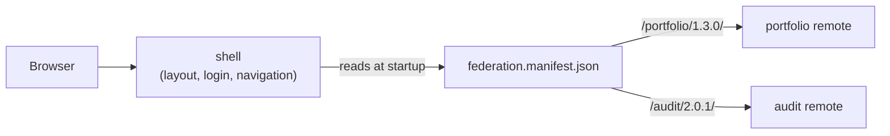

# Build and deployment

How the platform is expected to be built and deployed during feature
releases. CI/CD is not implemented; this describes how it would work.

## How the parts fit



- **One shell, many remotes.** The shell owns the frame that stays on screen
  (header, sidebar, login). Each instrument is a separate app (a "remote") that
  the shell loads when the user opens it.
- **Wired together at runtime, not at build time.** The shell finds the remotes
  through `federation.manifest.json` (see [versioning.md](versioning.md)), so
  building or deploying one app never requires rebuilding another.
- **Shared code is loaded once.** Angular, RxJS and the shared auth library
  (`libs/shared/auth`) are shared between all apps, so switching instruments
  doesn't reload the framework or lose the signed-in user.
- **One repository, separate ownership.** All apps live in one Nx monorepo.
  Each team owns its app folder (`apps/portfolio`, `apps/audit`, …), and shared
  code lives in `libs/shared`.

## Build

Every app builds on its own into plain static files:

```bash
npx nx build portfolio   # -> dist/apps/portfolio/browser (incl. remoteEntry.json)
```

In CI, Nx builds only the apps a change actually affects, using its project
graph:

```bash
npx nx affected -t build --base=<last released commit>
```

| A change in…                        | Rebuilds                      |
| ----------------------------------- | ----------------------------- |
| `apps/portfolio`                    | `portfolio` only              |
| `apps/audit`                        | `audit` only                  |
| `apps/shell`                        | `shell` only                  |
| `libs/shared/*` (auth state, theme) | `shell`, `portfolio`, `audit` |

## Deploy

The build output is static files, so any static hosting or CDN works (no
server rendering is needed; the platform is behind a login and needs no SEO).

Each app has its own pipeline and its own location:

- **A remote** (e.g. `portfolio`) is uploaded to its own version folder,
  `/portfolio/1.3.0/`. It goes live when its line in `federation.manifest.json`
  is switched to that folder; [versioning.md](versioning.md) describes release
  and rollback.
- **The shell** is uploaded to the site root. It changes rarely (layout,
  navigation, login) and its deploy does not overwrite the manifest.
- **A shared library change** affects every app, so all of them are rebuilt
  and released together. The same applies to an Angular upgrade, because shared
  packages must be the same version in every app.

Serving everything from one domain under different paths avoids cross-origin
issues. If remotes are hosted on another domain, they must send CORS headers
for the shell's origin.

## A feature release, step by step

The portfolio team ships a new feature:

1. The change is merged. `nx affected` reports only `portfolio`.
2. CI builds `portfolio` and uploads it to `/portfolio/1.3.0/`.
3. The manifest's `portfolio` line is switched to `1.3.0`.
4. Users get the feature the next time they open or reload the platform.

The shell and the audit instrument are not rebuilt or redeployed. If something
goes wrong, switching the line back to `1.2.0` rolls back immediately.
